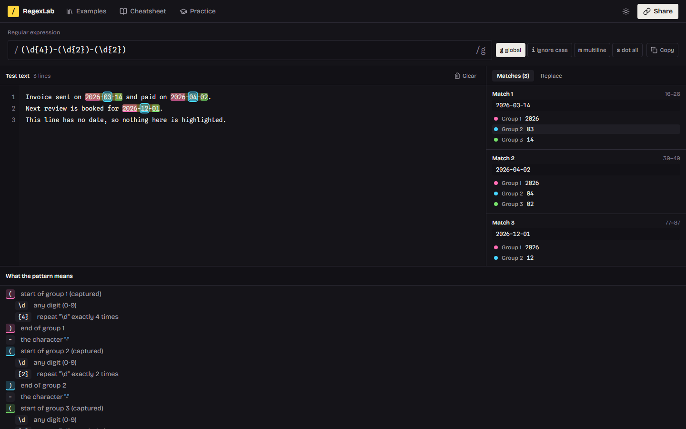

# RegexLab

[](https://github.com/notUbaid/RegexLab/actions/workflows/ci.yml)
[](LICENSE)

A regular expression tester that explains your pattern. Type a pattern, paste some text, and RegexLab highlights every match, lists the capture groups, and tells you what each part of the pattern means in plain English. It runs entirely in the browser.

**Live app:** https://regex-lab-delta.vercel.app



## Try it in 30 seconds

1. The app opens with `(\d{4})-(\d{2})-(\d{2})` already in the box: three dates light up, with the year, month and day in different colours.
2. Change the pattern to `\d+` and watch the highlights and the explanation update as you type.
3. Click **Examples** and pick **Email address** to load a real-world pattern with sample text.

## Features

- **Live highlighting.** Matches are highlighted in the text as you type, and each capture group gets its own colour.
- **Plain-English explanation.** The bottom panel splits the pattern into pieces and explains each one: `\d{4}` becomes "any digit (0-9)" + "repeat "\d" exactly 4 times".
- **Match list.** Every match with its position and capture groups. Hover a group to outline it in the text.
- **Find and replace.** Preview `text.replace(pattern, replacement)` with `$1`, `$2`, `$&` and `$<name>`.
- **Flags with names.** `g` global, `i` ignore case, `m` multiline, `s` dot all, each with a tooltip.
- **Helpful errors.** A broken pattern shows the browser's message plus a hint, e.g. "Unterminated group. Every ( needs a matching )."
- **Slow-pattern warning.** Nested repeats like `(a+)+`, which can freeze a program on some inputs, are flagged under the pattern box.
- **18 examples.** Email, URL, IPv4, dates, passwords, UUIDs and more, each with sample text that shows what passes and what fails.
- **Cheatsheet.** Click any token to insert it where your cursor is in the pattern.
- **11 practice exercises.** From easy to hard, checked as you type, with hints and answers. Progress is saved in your browser.
- **Share links.** The Share button copies a link that reopens the same pattern, flags and text.
- **Light and dark theme.**

## Run it locally

Needs [Node.js](https://nodejs.org) 22.18 or newer.

```bash
git clone https://github.com/notUbaid/RegexLab.git
cd RegexLab
npm install
npm run dev      # open http://localhost:5173
```

Other commands:

```bash
npm test         # engine tests (Node's built-in test runner, no extra packages)
npm run build    # type-check + production build into dist/
npm run preview  # serve the production build
```

## How it is built

React 19, TypeScript and Tailwind CSS, bundled with Vite. There is no backend.

Matching uses the browser's own `RegExp`, so the results are exactly what JavaScript does. The explanation comes from a small lexer written for this project, because the browser does not explain patterns.

```
src/
├── engine/                   Plain TypeScript, no React. Tested with npm test.
│   ├── analyze.ts            The one function the UI calls
│   ├── lexer.ts              Splits a pattern into tokens and describes each one
│   ├── matcher.ts            Runs the real RegExp and collects matches + group positions
│   ├── slowPattern.ts        Detects nested repeats like (a+)+
│   ├── types.ts              Token, Match, Group
│   └── engine.test.ts        Tests
├── components/
│   ├── Workspace.tsx         The screen: holds all state, calls analyze()
│   ├── Header.tsx            Top bar
│   ├── PatternInput.tsx      Pattern box, flags, error/warning
│   ├── TestEditor.tsx        Text box with highlighted matches
│   ├── ResultsPanel.tsx      Matches and Replace tabs
│   ├── ExplanationPanel.tsx  Plain-English breakdown
│   ├── Modal.tsx             Shared window frame
│   └── ExamplesModal / CheatsheetModal / PracticeModal
├── data/                     Examples, cheatsheet entries, practice exercises
└── useCopy.ts                Copy-to-clipboard helper
```

## Documentation

- [How it works](docs/HOW-IT-WORKS.md): a walkthrough of the code, in the order the data flows.
- [Demo walkthrough](docs/DEMO.md): a step-by-step script for showing the app, with the patterns to type and what you will see.

## Limitations

- Matching uses the browser's JavaScript regex engine, so syntax from other languages (like Python's `(?P<name>...)`) is not supported.
- The slow-pattern check only spots nested repeats such as `(a+)+`. It is a teaching aid, not a full ReDoS scanner.
- A truly catastrophic pattern on a long text can still freeze the tab, because the regex runs on the main thread.
- Error hints match Chrome and Edge's wording. Other browsers show their own error message without the extra hint.

## License

[MIT](LICENSE)
