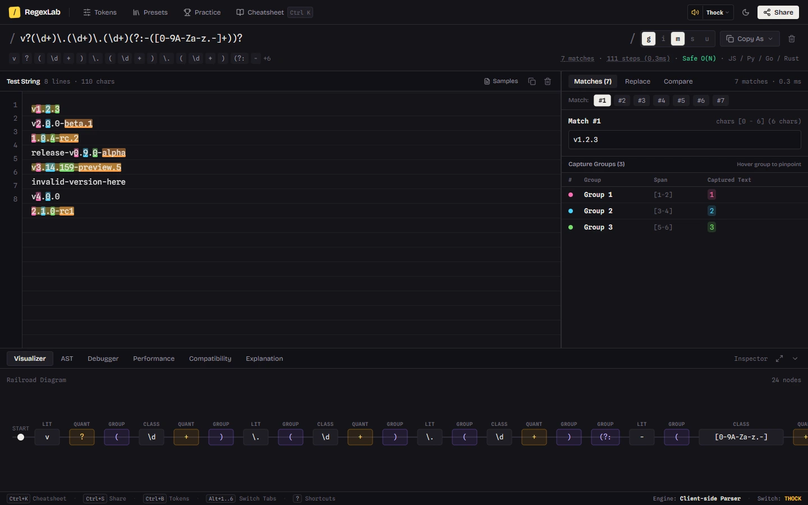

# RegexLab

A fast, client-side regular expression workbench and interactive execution visualizer. Built with React, TypeScript, and Tailwind CSS.



---

## Why I Built This

Most online regex testers fall into one of two traps: they are either covered in intrusive ads and bloated with slow cloud round-trips, or they stop at basic string matching without explaining *why* an expression failed or where it got stuck.

I built **RegexLab** to provide a clean, distraction-free IDE that runs 100% in your browser. It combines real-time match highlighting, an interactive state diagram, step-by-step backtracking traces, ReDoS risk detection, and procedural mechanical keyboard audio into a single unified workspace.

---

## Key Features

- **Instant Match Highlighting**: Matches and indexed capture groups (`$1`, `$2`, etc.) are layered directly underneath your test string with synchronized color tokens.
- **Interactive Railroad Diagram**: Visualizes your expression as an SVG state machine so you can trace branches, groups, and quantifiers at a glance.
- **Step-by-Step Backtrack Debugger**: An NFA state machine simulator that lets you scrub through each transition step-by-step to see where patterns advance, branch, or backtrack.
- **ReDoS Vulnerability Analysis**: Scans for catastrophic backtracking hazards (nested quantifiers, overlapping loops) with theoretical big-O classification ($O(N)$, $O(N^2)$, $O(2^N)$) and live stress testing.
- **Multi-Engine Code Export**: 1-click snippet generation for JavaScript, Python (`re.compile`), Rust (`regex::Regex`), Go (`regexp.MustCompile`), PCRE2, Java, and C# / .NET.
- **Web Audio Haptics**: Five zero-latency procedural click profiles synthesized directly in the browser via the Web Audio API (Lubed Linear, Clicky MX Blue, Tactile, IBM Model M, and 8-bit Cyber).
- **Interactive Syntax Tree (AST)**: Expandable syntax hierarchy showing token types, categories, and exact byte ranges.
- **Pattern Comparison & Replace**: Side-by-side regex diffing and a real-time replacement sandbox supporting `$&`, `$1`, and indexed backreferences.
- **Practice Challenges**: 11 progressive regex challenges (Novice through Grandmaster) with instant test validation and celebratory confetti.
- **Searchable Presets**: 50+ tested regex patterns for common use cases (SemVer, ISO dates, emails, JWTs, IPv4/IPv6, slugs, and sanitization).

---

## Keyboard Shortcuts

RegexLab is built for keyboard-driven efficiency:

| Shortcut | Action |
| :--- | :--- |
| <kbd>Ctrl</kbd> + <kbd>K</kbd> / <kbd>Cmd</kbd> + <kbd>K</kbd> | Open searchable syntax cheatsheet |
| <kbd>Ctrl</kbd> + <kbd>S</kbd> / <kbd>Cmd</kbd> + <kbd>S</kbd> | Copy shareable URL with pattern, flags, and test text |
| <kbd>Ctrl</kbd> + <kbd>B</kbd> / <kbd>Cmd</kbd> + <kbd>B</kbd> | Toggle token palette drawer |
| <kbd>Ctrl</kbd> + <kbd>P</kbd> / <kbd>Cmd</kbd> + <kbd>P</kbd> | Open presets library modal |
| <kbd>Alt</kbd> + <kbd>1</kbd> .. <kbd>6</kbd> | Switch bottom inspector tab (Visualizer, AST, Debugger, Performance, Compatibility, Explanation) |
| <kbd>?</kbd> | View shortcut help (when not focused in text inputs) |
| <kbd>Esc</kbd> | Close any open modal or drawer |

---

## Project Structure

The project separates parsing, simulation, and presentation into clean, self-contained modules:

```
src/
├── engine/             # Pure TypeScript regex engine
│   ├── lexer.ts        # Scans pattern string into tokens with byte spans
│   ├── parser.ts       # Builds recursive AST nodes from token stream
│   ├── matcher.ts      # Runs matches and simulates step-by-step NFA transitions
│   ├── complexity.ts   # ReDoS vulnerability detection & benchmark runner
│   ├── compatibility.ts# Multi-language syntax checker (JS, Python, Rust, Go, etc.)
│   ├── translator.ts   # Generates human-readable token explanations
│   └── analyze.ts      # Single-pass pipeline feeding all UI views
├── components/         # Workspace UI components
│   ├── Workspace.tsx   # Top-level state coordinator & keyboard shortcuts
│   ├── PatternInput.tsx# Pattern bar, flag pills & multi-engine code copy
│   ├── TestEditor.tsx  # Dual-layer match & capture-group highlighter
│   ├── MatchTable.tsx  # Match details, capture group pills & replace preview
│   ├── Railroad.tsx    # SVG railroad track visualization
│   ├── TraceDebugger.tsx # Step-by-step player with scrubber & timeline
│   ├── AstTree.tsx     # Collapsible syntax tree inspector
│   ├── PerformancePane.tsx # ReDoS hazard warnings & benchmark graph
│   ├── CompatibilityPane.tsx # Cross-engine compatibility tables & snippets
│   ├── LibraryModal.tsx    # 50+ searchable pattern presets
│   └── ChallengesModal.tsx # 11 interactive learning challenges
└── utils/
    ├── soundEffects.ts # Procedural Web Audio API sound synthesizer
    └── markup.tsx      # Syntax highlight token markup utilities
```

For a detailed walkthrough of how the parser and state simulator work, check out [`docs/ENGINE.md`](docs/ENGINE.md).

---

## Getting Started

### Prerequisites

- Node.js 18+
- npm, pnpm, or yarn

### Installation

```bash
# Clone the repository
git clone https://github.com/notUbaid/RegexLab.git

# Navigate into the project directory
cd RegexLab

# Install dependencies
npm install

# Start the development server
npm run dev
```

Open [http://localhost:5173](http://localhost:5173) in your browser.

### Production Build

```bash
npm run build
npm run preview
```

---

## Privacy & Security

- **100% Client-Side**: All regular expression matching, tokenization, and AST parsing run entirely in your local browser runtime.
- **Zero Telemetry**: No third-party analytics, tracking pixels, or external API dependencies.
- **No Data Retention**: Your test strings and regex patterns never leave your machine unless you explicitly generate and share a URL hash.

---

## License

This project is licensed under the [MIT License](LICENSE).

Created by [Ubaid](https://github.com/notUbaid). Pull requests and feature suggestions are welcome!
