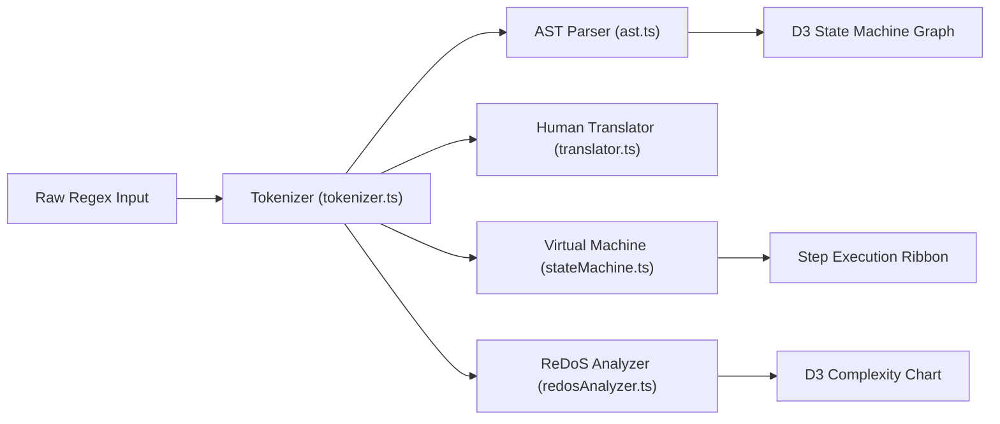

<div align="center">

# RegexLab
### The Visual Regular Expression Laboratory and Educational Playground

[](https://www.typescriptlang.org/)
[](https://react.dev/)
[](https://tailwindcss.com/)
[](https://threejs.org/)
[](https://d3js.org/)
[](LICENSE)

**Understand how regex engines think. Build, test, debug, and master regular expressions visually.**

[Features](#features-in-depth) | [Quick Start](#quick-start) | [Regex 101 Tutorial](#regex-101-for-absolute-beginners) | [Architecture](#architecture-and-data-pipelines) | [Engine Matrix](#multi-engine-compatibility-matrix)

---

</div>

## The Vision

Regular expressions are one of the most useful utilities in software development, but they can be confusing and intimidating when you are first learning them.

Most existing regex tools on the web are built for developers who already know regular expressions. They give you a text box, an input area, and a list of matches. They help you test patterns, but they do not really help you understand how the engine evaluates them.

RegexLab turns regular expressions from cryptic symbols into visual, intuitive, and interactive state machines.

Instead of staring at a pattern like this:
```regex
^(?=.*[A-Z])(?=.*\d)[a-zA-Z\d@$!%*?&]{8,}$
```

RegexLab breaks it down into plain English steps:
- Assert start of string (`^`)
- Positive lookahead: must contain at least one uppercase letter (`[A-Z]`)
- Positive lookahead: must contain at least one digit (`\d`)
- Between 8 and infinite allowed characters (`{8,}`)
- Assert end of string (`$`)

---

## Visual Tour

The application includes 11 dedicated tools, built in a dark obsidian theme with 6 switchable color palettes:

| View | Description | Screenshot |
| :--- | :--- | :--- |
| **01. Landing Hero** | Three.js 3D WebGL particle universe with an interactive live sandbox | [`screenshots/01-landing.png`](screenshots/01-landing.png) |
| **02. Playground** | Real-time editor with sub-pixel match highlighting and regex substitution preview | [`screenshots/02-playground.png`](screenshots/02-playground.png) |
| **03. Engine Visualizer** | Interactive D3.js Finite Automaton State Graph and step-by-step debugger | [`screenshots/03-visualizer.png`](screenshots/03-visualizer.png) |
| **04. Visual Builder** | No-code block constructor with live regex compilation and plain-English preview | [`screenshots/04-builder.png`](screenshots/04-builder.png) |
| **05. AST Explorer** | Hierarchical Abstract Syntax Tree with interactive pan and zoom controls | [`screenshots/05-ast.png`](screenshots/05-ast.png) |
| **06. Regex Debugger** | Locates exact character offsets where matches fail and provides 1-click fixes | [`screenshots/06-debugger.png`](screenshots/06-debugger.png) |
| **07. ReDoS Analyzer** | Catastrophic backtracking detector with interactive D3.js complexity curves | [`screenshots/07-performance.png`](screenshots/07-performance.png) |
| **08. Compatibility** | 7-engine feature detection matrix (JS, Python, PCRE2, Java, Go, Rust, .NET) | [`screenshots/08-compatibility.png`](screenshots/08-compatibility.png) |
| **09. Pattern Library** | Searchable catalog of production-tested regular expressions | [`screenshots/09-library.png`](screenshots/09-library.png) |
| **10. Pattern Compare** | Side-by-side pattern comparison: readability, AST complexity, and steps | [`screenshots/10-compare.png`](screenshots/10-compare.png) |
| **11. Challenges** | Progressive interactive puzzles (Novice to Grandmaster) with live tests | [`screenshots/11-challenges.png`](screenshots/11-challenges.png) |

---

## Quick Start

### Prerequisites
- Node.js version 18.0 or higher
- npm, pnpm, or yarn

### Installation and Local Development
```bash
# 1. Clone the repository
git clone https://github.com/your-username/regexlab.git
cd regexlab

# 2. Install project dependencies
npm install

# 3. Start the Vite development server
npm run dev
```

Open your browser and navigate to `http://localhost:5173`.

### Production Build
```bash
# Type check and build production bundle
npm run build

# Preview the production build locally
npm run preview -- --port 4173
```

---

## Regex 101 for Absolute Beginners

If regular expressions are brand new to you, here is a quick overview of the most common symbols you will encounter:

### 1. Position Anchors (Where to Match)
- `^`: **Start of Line** - Asserts that the match starts at the beginning of the text (or line with `/m` flag).
- `$`: **End of Line** - Asserts that the match ends at the end of the text.
- `\b`: **Word Boundary** - Matches the boundary between a word character and a non-word character (e.g. spaces or punctuation).

### 2. Character Classes (What Characters to Match)
- `\d`: Any **digit** from `0` to `9` (same as `[0-9]`).
- `\D`: Any **non-digit** character.
- `\w`: Any **word character** (letters `a-z`, `A-Z`, digits `0-9`, and underscore `_`).
- `\W`: Any **non-word character**.
- `\s`: Any **whitespace** character (space, tab, or newline).
- `\S`: Any **non-whitespace** character.
- `.`: **Wildcard** - Matches any single character except line breaks.
- `[abc]`: **Character Set** - Matches either `'a'`, `'b'`, or `'c'`.
- `[^abc]`: **Negated Character Set** - Matches any character except `'a'`, `'b'`, or `'c'`.

### 3. Quantifiers (How Many Times to Match)
- `*`: **Zero or more times** (optional repeat, greedy).
- `+`: **One or more times** (at least once, greedy).
- `?`: **Optional** (0 or 1 time).
- `{3}`: Exactly **3 times**.
- `{2,5}`: Between **2 and 5 times**.
- `*?` or `+?`: **Lazy Quantifier** - Matches as few characters as possible rather than as many as possible.

### 4. Groups and Lookarounds
- `(abc)`: **Capture Group** - Groups patterns together and saves the matched text into group variables (`$1`, `$2`).
- `(?:abc)`: **Non-Capturing Group** - Groups patterns for repetition without saving them into capture memory.
- `(?<name>abc)`: **Named Capture Group** - Captures text into a named variable (`groups.name`).
- `(?=abc)`: **Positive Lookahead** - Asserts that `'abc'` follows immediately without including it in the match.
- `(?!abc)`: **Negative Lookahead** - Asserts that `'abc'` does not follow.

---

## Features in Depth

### 1. Interactive Regex Playground
- Real-time syntax validation with inline error feedback.
- Sub-pixel layered text highlighting: match backgrounds and 8 distinct capture group colors sit directly underneath your editable textarea with character-level accuracy.
- Substitution sandbox supporting `$1`, `$2`, `$&`, and `$\`` replacement variables.
- One-click token inserters for common patterns (`\d`, `\w`, `\s`, `[a-z]`, `(...)`, `a|b`).

### 2. Live Human Translator
- Converts regular expression tokens into plain English sentences as you type.
- Bidirectional hover highlighting: hover over any token in the regex editor to highlight the corresponding explanation, or hover over an explanation card to highlight the token in the pattern.

### 3. Engine Visualizer with D3.js State Machine Graph
- Watch how a regex virtual machine executes step-by-step.
- Interactive D3 vector state graph featuring cubic bezier curves, traversal particle animations, and pulsing active state rings.
- Frame scrubber, playback controls, adjustable speeds (0.5x, 1x, 2x, 5x), and backtracking alerts.

### 4. Visual No-Code Regex Builder
- Assemble regular expressions without having to write syntax by hand.
- Add blocks for letters, digits, whitespace, ranges, and custom character sets with intuitive repetition dropdowns.
- Live regex compilation and synchronized plain-English preview.

### 5. AST Explorer
- Hierarchical syntax tree explorer with pan, zoom, expand, and collapse actions.
- Detailed token attribute inspector showing character ranges, quantifier bounds, and capture group indices.

### 6. Regex Failure Debugger
- When a match fails, RegexLab shows where and why it failed.
- Pinpoints the character index where the engine stopped matching.
- Highlights the expected token, the actual character found, and offers one-click fixes.

### 7. Performance and ReDoS Analyzer
- Scans patterns for catastrophic backtracking risks (nested quantifiers like `(a+)+` or overlapping alternations like `(a|a)+`).
- Interactive D3 theoretical complexity chart comparing linear $O(N)$, polynomial $O(N^k)$, and exponential $O(2^N)$ curves with an adjustable text length slider.

### 8. Multi-Engine Compatibility Matrix
- Evaluates feature support across 7 engines: **JavaScript**, **Python**, **PCRE2**, **Java**, **Go (RE2)**, **Rust**, and **.NET**.
- Explains engine architectural differences and provides equivalent translated patterns when syntax is unsupported.

### 9. Tactile Web Audio Sound Synthesizer
- Zero external audio files to download; generates procedural acoustic feedback using the browser Web Audio API:
  - 800Hz damped mechanical clicks on keystrokes.
  - 1200Hz subtle ticks on debugger stepping.
  - Harmonic 4-tone chord arpeggio (C5-E5-G5-C6) on match success and challenge completion.
  - 90Hz sawtooth hum on ReDoS risk alerts.
  - Global sound toggle in the header.

---

## Multi-Engine Compatibility Matrix

| Feature | JavaScript (V8) | Python (re) | PCRE2 / PHP | Java (util.regex) | Go (RE2) | Rust (regex) | .NET (C#) |
| :--- | :---: | :---: | :---: | :---: | :---: | :---: | :---: |
| **Lookaheads `(?=)`** | Yes | Yes | Yes | Yes | No *(linear O(N))* | No *(linear O(N))* | Yes |
| **Fixed Lookbehinds `(?<=)`** | Yes | Yes | Yes | Yes | No | No | Yes |
| **Variable Lookbehinds** | Yes *(V8 only)* | No *(needs `regex`)* | Yes | Partial *(finite max)* | No | No | Yes |
| **Named Groups `(?<name>)`** | Yes | Partial `(?P<name>)` | Yes | Yes | Partial `(?P<name>)` | Partial `(?P<name>)` | Yes |
| **Possessive Quantifiers `++`** | No | No *(needs `regex`)* | Yes | Yes | No | No | Yes |
| **Atomic Groups `(?>)`** | No | No | Yes | Yes | No | No | Yes |
| **Unicode Properties `\p{L}`** | Yes *(with `u`)* | Yes | Yes | Yes | Yes | Yes | Yes |
| **ReDoS Vulnerability** | Possible | Possible | Possible | Possible | Immune | Immune | Safe *(with timeout)* |

---

## Architecture and Data Pipelines



For complete technical documentation:
- [System Architecture and State Flow](docs/ARCHITECTURE.md)
- [Engine Guide and ReDoS Mathematics](docs/ENGINE_GUIDE.md)
- [Parser Pipeline and Compiler Guide](docs/PARSER_PIPELINE.md)
- [Coding Standards and Best Practices](docs/CODING_STANDARDS.md)

---

## Design System and Color Themes

RegexLab includes 6 high-contrast themes accessible from the palette dropdown in the header:

1. **Midnight Slate** (Default): Modern obsidian slate background with cyan accents.
2. **Crisp Light**: Clean editorial white canvas with sapphire blue accents.
3. **Cosmic Indigo**: Deep space dark navy with soft purple accents.
4. **OLED Vantablack**: Pitch black (`#000000`) with emerald green highlights.
5. **Nord Arctic**: Nordic frost palette with cool glacier blues.
6. **Dracula Noir**: Dark vampire theme with pink and purple accents.

---

## Testing and Quality Verification

RegexLab is thoroughly verified:
- **Build Quality**: Verified with `tsc -b && vite build` (2,598 modules transformed with 0 errors).
- **Screenshot Verification**: Automated 1920x1080 screenshot captures across all 11 views using Puppeteer in `scripts/take-screenshots.mjs`.
- **Zero Placeholders**: Every parser, token branch, debugger suggestion, and challenge is completely implemented.

---

## Contributing

Contributions are welcome. Here is how to get started:
1. Fork the repository.
2. Create a feature branch: `git checkout -b feat/my-new-feature`.
3. Follow the project [Coding Standards](docs/CODING_STANDARDS.md) (no `any` types, keep code simple, readable, and beginner-friendly).
4. Run `npm run build` to confirm compilation passes.
5. Submit a pull request.

---

## License

This project is licensed under the MIT License - see the [LICENSE](LICENSE) file for details.
