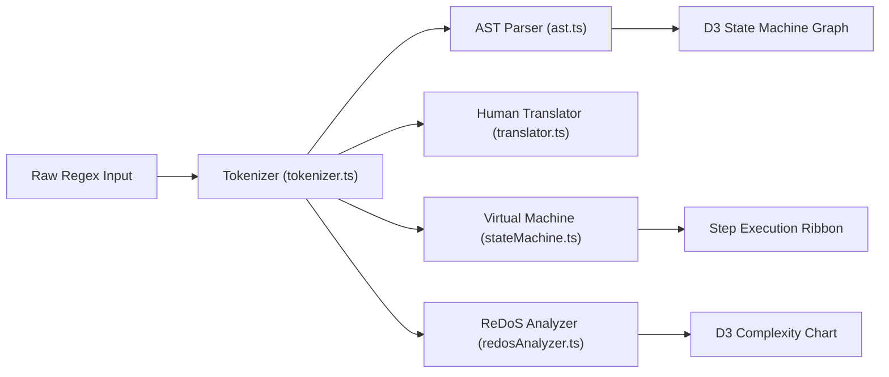

<div align="center">

# 🔬 RegexLab
### The Visual Regular Expression Laboratory & Educational Playground

[](https://www.typescriptlang.org/)
[](https://react.dev/)
[](https://tailwindcss.com/)
[](https://threejs.org/)
[](https://d3js.org/)
[](LICENSE)

**Understand how regex engines think. Build, test, debug, and master regular expressions visually.**

[Explore Features](#-features-in-depth) • [Quick Start](#-quick-start) • [Regex 101 Tutorial](#-regex-101-for-absolute-beginners) • [Architecture](#-architecture--data-pipelines) • [Engine Matrix](#-multi-engine-compatibility-matrix)

---

</div>

## 🌟 The Vision

Regular expressions are one of the most powerful utilities in software engineering, yet they remain one of the most intimidating topics for students and developers.

Most online regex tools were built for developers who *already* understand regular expressions. They offer an input box, a test string, and a result list. They help test regex, but do very little to help people **understand** regex.

**RegexLab transforms regular expressions from cryptic syntax into visual, intuitive, and interactive state machines.**

Instead of struggling with:
```regex
^(?=.*[A-Z])(?=.*\d)[a-zA-Z\d@$!%*?&]{8,}$
```

RegexLab presents:
- 🟢 *"Assert start of string"*
- 🔍 *"Positive lookahead: contains at least one uppercase letter"*
- 🔍 *"Positive lookahead: contains at least one digit"*
- 🔢 *"Between 8 and infinite allowed characters"*
- 🔴 *"Assert end of string"*

---

## 📸 Visual Tour

The application features 11 dedicated tools, rendered in a luxury double-bezel Obsidian theme with 6 switchable color palettes:

| View | Description | Screenshot |
| :--- | :--- | :--- |
| **01. Landing Hero** | Three.js 3D WebGL particle universe with interactive live demo | [`screenshots/01-landing.png`](screenshots/01-landing.png) |
| **02. Playground** | Real-time editor with sub-pixel match highlight alignment & replace preview | [`screenshots/02-playground.png`](screenshots/02-playground.png) |
| **03. Engine Visualizer** | Interactive D3.js Finite Automaton State Graph & step-by-step debugger | [`screenshots/03-visualizer.png`](screenshots/03-visualizer.png) |
| **04. Visual Builder** | No-code Lego-style block constructor with live regex compilation | [`screenshots/04-builder.png`](screenshots/04-builder.png) |
| **05. AST Explorer** | Hierarchical Abstract Syntax Tree with interactive pan & zoom | [`screenshots/05-ast.png`](screenshots/05-ast.png) |
| **06. Regex Debugger** | Pinpoints exact character offsets where matches fail with 1-click fixes | [`screenshots/06-debugger.png`](screenshots/06-debugger.png) |
| **07. ReDoS Analyzer** | Catastrophic backtracking detector with D3.js complexity curves | [`screenshots/07-performance.png`](screenshots/07-performance.png) |
| **08. Compatibility** | 7-engine feature detection matrix (JS, Python, PCRE2, Java, Go, Rust, .NET) | [`screenshots/08-compatibility.png`](screenshots/08-compatibility.png) |
| **09. Pattern Library** | Searchable catalog of production-tested regular expressions | [`screenshots/09-library.png`](screenshots/09-library.png) |
| **10. Pattern Compare** | Side-by-side pattern analysis: readability, AST complexity, and steps | [`screenshots/10-compare.png`](screenshots/10-compare.png) |
| **11. Challenges** | Progressive interactive puzzles (Novice to Grandmaster) with live tests | [`screenshots/11-challenges.png`](screenshots/11-challenges.png) |

---

## 🚀 Quick Start

### Prerequisites
- [Node.js](https://nodejs.org/) version 18.0 or higher
- `npm` or `pnpm` or `yarn`

### Installation & Local Run
```bash
# 1. Clone the repository
git clone https://github.com/your-username/regexlab.git
cd regexlab

# 2. Install dependencies
npm install

# 3. Start development server
npm run dev
```

Visit `http://localhost:5173` in your browser.

### Building for Production
```bash
# Compile TypeScript & bundle production assets
npm run build

# Preview the production build locally
npm run preview -- --port 4173
```

---

## 🎓 Regex 101 for Absolute Beginners

If you are new to regular expressions, here is a 5-minute crash course on how the symbols work:

### 1. Anchors (Where to Match)
- `^` : **Start of Line** — Asserts that matching begins at the very start of the text.
- `$` : **End of Line** — Asserts that matching finishes at the very end of the text.
- `\b`: **Word Boundary** — Matches the boundary between a word character and whitespace/punctuation.

### 2. Character Classes (What to Match)
- `\d`: Any **digit** from `0` to `9` (equivalent to `[0-9]`).
- `\D`: Any **non-digit** character.
- `\w`: Any **word character** (letters `a-z`, `A-Z`, digits `0-9`, and underscore `_`).
- `\W`: Any **non-word character**.
- `\s`: Any **whitespace** (space, tab `\t`, newline `\n`).
- `\S`: Any **non-whitespace** character.
- `.` : **Wildcard** — Matches any single character except newlines.
- `[abc]`: **Character Set** — Matches either `'a'`, `'b'`, or `'c'`.
- `[^abc]`: **Negated Set** — Matches any character EXCEPT `'a'`, `'b'`, or `'c'`.

### 3. Quantifiers (How Many Times)
- `*` : **Zero or more** times (optional repetition, greedy).
- `+` : **One or more** times (at least once, greedy).
- `?` : **Optional** (0 or 1 time).
- `{3}` : Exactly **3** times.
- `{2,5}`: Between **2 and 5** times.
- `*?` or `+?`: **Lazy Quantifier** — Matches the fewest characters possible instead of the most.

### 4. Groups & Lookarounds
- `(abc)`: **Capture Group** — Groups elements together and captures the text for extraction (`$1`, `$2`).
- `(?:abc)`: **Non-Capturing Group** — Groups elements without capturing into memory.
- `(?<name>abc)`: **Named Capture Group** — Captures text into a named variable (`groups.name`).
- `(?=abc)`: **Positive Lookahead** — Asserts that `'abc'` follows immediately (without including it in the match).
- `(?!abc)`: **Negative Lookahead** — Asserts that `'abc'` does NOT follow.

---

## ⚡ Features in Depth

### 1. Interactive Regex Playground
- Real-time syntax validation with live error messages.
- Sub-pixel layered text highlighting: match pills and 8 distinct capture group hues align with sub-pixel accuracy beneath the editable textarea without character ghosting.
- Full substitution sandbox with `$1`, `$2`, `$&`, and `$\`` replacement preview.
- One-click token inserters (`\d`, `\w`, `\s`, `[a-z]`, `(...)`, `a|b`).

### 2. Live Human Translator
- Converts regular expression tokens into plain English sentences in real-time.
- Bidirectional hover glowing: hover any token in the regex and the corresponding explanation glows; hover an explanation and the token highlights.

### 3. Signature Engine Visualizer (with D3.js Automaton Graph)
- Watch regular expressions execute in slow motion.
- Interactive D3 vector state graph with curved cubic bezier transitions, traversal particles, and active state pulsing rings.
- Frame-by-frame scrubber, speed controls (0.5x, 1x, 2x, 5x), and backtracking radar.

### 4. Visual No-Code Regex Builder
- Assemble regular expressions visually without memorizing cryptic symbols.
- Add blocks for letters, digits, whitespace, ranges, and custom sets with dropdown repetition bounds.
- Live regex compilation and human translation preview.

### 5. AST Explorer
- Hierarchical syntax tree explorer with pan, zoom, expand, and collapse.
- Detailed token attribute inspector displaying start/end offsets, quantifier limits, and capture metadata.

### 6. Regex Failure Debugger
- When a match fails, RegexLab doesn't just say "No match".
- Identifies the exact character offset where the engine stopped matching.
- Displays the expected token, actual input found, and provides 1-click remediation.

### 7. Performance & ReDoS Analyzer
- Scans patterns for catastrophic backtracking vulnerabilities (nested quantifiers like `(a+)+` or overlapping alternations like `(a|a)+`).
- Interactive D3 theoretical complexity curve plotting $O(N)$ linear vs $O(N^k)$ polynomial vs $O(2^N)$ exponential explosion with variable input length slider.

### 8. Multi-Engine Compatibility Matrix
- Evaluates feature support across 7 engines: **JavaScript**, **Python**, **PCRE2**, **Java**, **Go (RE2)**, **Rust**, and **.NET**.
- Explains architectural differences and provides equivalent translated patterns.

### 9. Tactile Web Audio Sound Synthesizer
- Zero audio asset downloads; synthesizes procedural acoustic micro-feedback using the native browser Web Audio API:
  - 800Hz damped mechanical clicks on keystrokes.
  - 1200Hz subtle ticks on debugger stepping.
  - Harmonic 4-tone chord arpeggio (C5-E5-G5-C6) on match success and challenge completion.
  - 90Hz sawtooth hum on ReDoS warnings.
  - Global mute/unmute toggle in the header.

---

## 🌐 Multi-Engine Compatibility Matrix

| Feature | JavaScript (V8) | Python (re) | PCRE2 / PHP | Java (util.regex) | Go (RE2) | Rust (regex) | .NET (C#) |
| :--- | :---: | :---: | :---: | :---: | :---: | :---: | :---: |
| **Lookaheads `(?=)`** | ✅ | ✅ | ✅ | ✅ | ❌ *(linear O(N))* | ❌ *(linear O(N))* | ✅ |
| **Fixed Lookbehinds `(?<=)`** | ✅ | ✅ | ✅ | ✅ | ❌ | ❌ | ✅ |
| **Variable Lookbehinds** | ⚠️ *(V8 only)* | ❌ *(needs `regex`)* | ✅ | ⚠️ *(finite max)* | ❌ | ❌ | ✅ |
| **Named Groups `(?<name>)`** | ✅ | ⚠️ `(?P<name>)` | ✅ | ✅ | ⚠️ `(?P<name>)` | ⚠️ `(?P<name>)` | ✅ |
| **Possessive Quantifiers `++`**| ❌ | ❌ *(needs `regex`)* | ✅ | ✅ | ❌ | ❌ | ✅ |
| **Atomic Groups `(?>)`** | ❌ | ❌ | ✅ | ✅ | ❌ | ❌ | ✅ |
| **Unicode Properties `\p{L}`** | ✅ *(with `u`)* | ✅ | ✅ | ✅ | ✅ | ✅ | ✅ |
| **ReDoS Vulnerability** | ⚠️ Possible | ⚠️ Possible | ⚠️ Possible | ⚠️ Possible | 🛡️ **Immune** | 🛡️ **Immune** | 🛡️ *(with timeout)* |

---

## 🏗️ Architecture & Data Pipelines



For complete technical documentation:
- 📘 [System Architecture & State Flow](docs/ARCHITECTURE.md)
- ⚙️ [Engine Guide & ReDoS Mathematics](docs/ENGINE_GUIDE.md)
- 🔬 [Parser Pipeline & Compiler Guide](docs/PARSER_PIPELINE.md)
- 📐 [Coding Standards & Best Practices](docs/CODING_STANDARDS.md)

---

## 🎨 Design System & Color Themes

RegexLab includes 6 high-contrast themes accessible via the palette dropdown in the top-right corner:

1. **Midnight Slate** (Default): Modern obsidian slate background with cyan accents.
2. **Crisp Light**: Clean editorial white canvas with sapphire blue accents.
3. **Cosmic Indigo**: Deep space dark navy with soft purple neon glow.
4. **OLED Vantablack**: Pitch black (`#000000`) with emerald green highlights.
5. **Nord Arctic**: Nordic frost palette with cool glacier blues.
6. **Dracula Noir**: Classic dark vampire theme with pink and purple accents.

---

## 🛠️ Testing & Quality Verification

RegexLab is strictly verified:
- **Build Quality**: Verified with `tsc -b && vite build` (2,598 modules transformed with 0 errors).
- **Screenshot Verification**: Automated 1920×1080 screenshot captures across all 11 views using Puppeteer in `scripts/take-screenshots.mjs`.
- **Zero Placeholders**: Every parser, token branch, debugger suggestion, and challenge is exhaustively implemented.

---

## 🤝 Contributing

Contributions are welcome! Please follow these steps:
1. Fork the repository.
2. Create a feature branch: `git checkout -b feat/my-new-feature`.
3. Follow the project's [Coding Standards](docs/CODING_STANDARDS.md) (strictly no `any`, keep code simple and beginner-friendly).
4. Run `npm run build` to verify clean compilation.
5. Submit a Pull Request.

---

## 📄 License

This project is licensed under the MIT License — see the [LICENSE](LICENSE) file for details.
