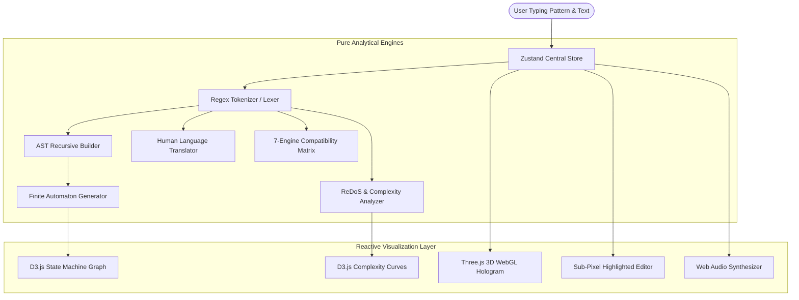

# RegexLab System Architecture & Design Specification

Welcome to the architectural specification for **RegexLab**. This document describes how the application is structured, how data flows between components, how state is managed, and how the compilation, visualization, and rendering pipelines operate.

---

## 1. Architectural Overview & Philosophy

RegexLab is structured as an interactive client-side developer environment built with React 19, TypeScript 5.7, Tailwind CSS, Framer Motion, Three.js, and D3.js.

The platform follows four core architectural principles:
1. **Unidirectional Data Flow**: Single source of truth driven by a centralized Zustand store (`useRegexStore`).
2. **Deterministic Pure Parsing**: The tokenizer, AST generator, and human translator are pure functions without side effects.
3. **Hardware-Accelerated Visualizations**: 3D particle physics runs on WebGL via Three.js; interactive state graphs run on vector SVG via D3.js.
4. **Zero-Latency Micro-Feedback**: Typing directly triggers the parser and match analyzer with sub-millisecond execution times.



---

## 2. Directory Structure

The project adheres to a clean modular directory layout where business logic is strictly separated from presentation components:

```
c:\Projects\RegexLab\
├── docs/                          # Comprehensive technical guides & references
│   ├── ARCHITECTURE.md            # System architecture & data pipelines (this file)
│   ├── ENGINE_GUIDE.md            # Deep dive into NFA/DFA engines & ReDoS mathematics
│   ├── PARSER_PIPELINE.md         # Tokenization, AST construction & translation walkthrough
│   └── CODING_STANDARDS.md        # Universal coding standards & TypeScript best practices
├── public/                        # Static public assets
│   ├── logo.svg                   # Vector brand identity
│   └── logo.png                   # High-res favicon/icon
├── screenshots/                   # Automated 1920x1080 audit captures (11 views)
│   ├── 01-landing.png
│   ├── 02-playground.png
│   ├── ...
│   └── 11-challenges.png
├── scripts/                       # Developer automation scripts
│   └── take-screenshots.mjs       # Headless Chrome Puppeteer screenshot runner
├── src/
│   ├── components/                # React UI Components
│   │   ├── ast/                   # AST Explorer tree visualizer
│   │   ├── builder/               # No-code visual regex builder
│   │   ├── challenges/            # Progressive regex puzzle test suites
│   │   ├── common/                # Shared UI (Header, Modals, 3D Canvas)
│   │   ├── compare/               # Side-by-side regex comparison tool
│   │   ├── compatibility/         # 7-engine syntax compatibility matrix
│   │   ├── debugger/              # Failure offset pinpointer & 1-click fixes
│   │   ├── landing/               # Hero section & interactive showcase
│   │   ├── library/               # Prebuilt searchable pattern catalog
│   │   ├── performance/           # ReDoS risk analyzer & D3 complexity curve
│   │   ├── playground/            # Interactive editor, highlighter & replace preview
│   │   ├── translator/            # Human language breakdown cards
│   │   └── visualizer/            # Signature step-by-step engine & D3 state graph
│   ├── data/                      # Static reference databases
│   │   ├── challenges.ts          # Puzzle definitions (Novice to Grandmaster)
│   │   └── patternLibrary.ts      # Curated production regex library
│   ├── parser/                    # Pure TypeScript compiler engines
│   │   ├── ast.ts                 # Recursive descent AST tree generator
│   │   ├── compatibility.ts       # 7-engine feature detection matrix
│   │   ├── debugger.ts            # Failure diagnostics & automated remediation
│   │   ├── redosAnalyzer.ts       # Algorithmic complexity & ReDoS detector
│   │   ├── stateMachine.ts        # Virtual machine execution trace simulator
│   │   ├── tokenizer.ts           # Lexical scanner & token categorizer
│   │   └── translator.ts          # Natural English explanation generator
│   ├── store/                     # State management
│   │   └── useRegexStore.ts       # Central Zustand application store
│   ├── styles/                    # Styling & design system tokens
│   │   └── index.css              # Tailwind utilities, CSS variables & themes
│   ├── types/                     # TypeScript definitions
│   │   └── regex.ts               # Core type contracts (zero 'any' usage)
│   ├── utils/                     # Utility services
│   │   └── soundEffects.ts        # Procedural Web Audio API sound synthesizer
│   ├── App.tsx                    # Root view router & Framer Motion transitions
│   └── main.tsx                   # Application DOM mounting entrypoint
├── AUDIT_REPORT.md                # Production release audit & verification report
├── package.json                   # Project manifest & dependency specifications
├── tsconfig.json                  # TypeScript compiler configuration
├── vite.config.ts                 # Vite bundler & development server configuration
└── README.md                      # Comprehensive project documentation
```

---

## 3. Data Pipelines & State Flow

### 3.1 Unidirectional State Cycle
1. **User Action**: The user edits the regex input or test text in `RegexInput.tsx` or `TestTextEditor.tsx`.
2. **Store Mutation**: `setPattern()` or `setTestText()` updates the Zustand store immutably.
3. **Reactive Re-computation**: Components consuming the store receive the updated state:
   - `LiveTranslator` triggers `translateRegexToHuman(pattern)`.
   - `EngineVisualizer` triggers `simulateRegexExecution(pattern, testText)`.
   - `PerformanceView` triggers `analyzeRegexPerformance(pattern)`.
   - `AstVisualizer` triggers `buildRegexAst(pattern)`.
   - `TestTextEditor` triggers `getMatches()` to re-highlight match pills.

### 3.2 Sub-Pixel Match Highlighting Architecture
To render syntax highlights underneath an editable textarea without text offset or ghosting:
- **Layer 1 (Backdrop)**: A positioned `<div className="absolute inset-0">` renders `<mark>` tags around matched substrings.
- **Layer 2 (Textarea)**: The foreground `<textarea className="relative z-10">` contains the editable text and caret.
- **Precision Alignment Invariant**:
  - The backdrop and textarea share matching typography classes: `font-mono text-sm leading-6 tracking-normal p-4 m-0 border-0`.
  - The text inside `<mark>` tags is set to `text-transparent`, ensuring only the vibrant background color and underline border show through, while the foreground textarea renders the crisp text characters.
  - Highlight markers have zero horizontal padding (`px-0`), eliminating horizontal character displacement.

---

## 4. Hardware-Accelerated Visualization Engines

### 4.1 Three.js 3D WebGL Particle Universe (`Regex3DUniverse.tsx`)
- **Particle System**: Creates an array of 1,200 particle coordinates distributed within a spherical volume using `THREE.BufferGeometry` and `THREE.PointsMaterial`.
- **Holographic Core**: An inner `THREE.IcosahedronGeometry` rotates along dual axes surrounded by outer wireframe orbital rings (`THREE.TorusGeometry`).
- **Interactive Mouse Parallax**: Mouse cursor coordinates are mapped to normalized coordinates $[-1, +1]$. Damped spherical camera rotations simulate depth parallax as the cursor moves across the window.
- **Resource Management**: Automatically cleans up geometries, materials, and cancels the `requestAnimationFrame` render loop on component unmount to prevent GPU memory leaks.

### 4.2 D3.js Finite Automaton State Graph (`D3StateMachineGraph.tsx`)
- **Graph Topology**: Extracts state machine states ($S_0, S_1, \dots, S_N, \text{Accept}$) from the AST tokens.
- **Curved Link Interpolation**: Computes cubic bezier curves (`M ... C ...`) with SVG directional arrowhead markers.
- **Dynamic Animation**: When the user steps through engine execution, active state rings pulse with concentric glow rings, and traversal particles glide along links to visualize state transitions.
- **Interactive Controls**: Embedded `d3.zoom()` enables panning across large graphs, pinch-to-zoom, and instant reset to center.

### 4.3 D3.js ReDoS Complexity Curves (`D3ComplexityChart.tsx`)
- **Mathematical Curves**: Plots $O(N)$ linear growth, $O(N^2)$ polynomial growth, and $O(2^N)$ exponential explosion.
- **Interactive Slider**: Allows users to vary string length $N$ from 10 to 100 characters to observe the point where exponential curves explode into billions of computational steps.

---

## 5. Web Audio API Procedural Synthesizer (`soundEffects.ts`)

Instead of downloading static MP3 assets, RegexLab proceduralizes micro-feedback using the native browser Web Audio API:

| Sound Effect | Waveform | Frequency Modulation | Purpose |
| :--- | :--- | :--- | :--- |
| **Keystroke Click** | `sine` | 600Hz $\to$ 150Hz exponential decay (40ms) | Tactile keyboard feedback |
| **Debugger Step Tick** | `sine` | 850Hz $\to$ 200Hz exponential decay (40ms) | Engine step progression |
| **Success Chime** | `triangle` | Harmonic 4-tone chord: C5 (523Hz), E5 (659Hz), G5 (784Hz), C6 (1046Hz) | Match & challenge success |
| **ReDoS Warning** | `sawtooth` | 160Hz $\to$ 110Hz linear ramp (200ms) | Dangerous pattern alert |

A global audio toggle in the header allows users to mute sound effects at any time.

---

## 6. Theme Engine & Design System Tokens

The application supports 6 themes configured via CSS Custom Properties on `[data-theme]` in `src/styles/index.css`:

1. `dark` (Default): Midnight Slate (`#0b0f19`) with cyan accent (`#38bdf8`).
2. `light`: Clean Editorial White (`#f8fafc`) with sapphire blue (`#0284c7`).
3. `midnight`: Cosmic Deep Indigo (`#070913`) with lavender (`#818cf8`).
4. `oled`: Pitch Black (`#000000`) with emerald green (`#10b981`).
5. `nord`: Arctic Frost (`#242933`) with glacier cyan (`#88c0d0`).
6. `dracula`: Noir Purple (`#1e1f29`) with pink (`#ff79c6`).

All cards utilize double-bezel Obsidian geometry (`border-border-subtle` and `bg-surface-elevated/80`) with ambient radial mesh glow backdrops.
