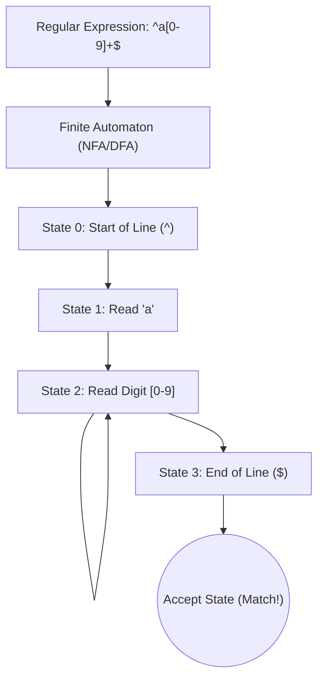

# The Comprehensive Guide to Regular Expression Engines & ReDoS

Welcome to the **RegexLab Engine Deep Dive**. This guide is written for both beginners learning regular expressions for the first time and experienced developers seeking to understand how regex engines work under the hood.

---

## 1. What Is a Regular Expression?

In theoretical computer science, a regular expression is a formal sequence of characters defining a search pattern. It corresponds to **Type-3 grammars** in the Chomsky hierarchy (Regular Languages), which can be recognized by **Finite State Automata**.



---

## 2. NFA vs DFA: The Two Engine Philosophies

Modern regular expression engines generally fall into one of two fundamental categories:

| Feature | NFA (Non-deterministic Finite Automaton) | DFA (Deterministic Finite Automaton) |
| :--- | :--- | :--- |
| **Used By** | JavaScript, Python, PCRE2, Java, .NET | Go (RE2), Rust (`regex` crate) |
| **Execution Time** | Worst-case $O(2^N)$ Exponential | Guaranteed $O(N)$ Linear |
| **Memory Usage** | Minimal ($O(1)$ stack states) | Can grow large during DFA state caching |
| **Lookaround Support** | Full support (`(?=...)`, `(?<=...)`) | **Forbidden** |
| **Backreference Support** | Full support (`\1`, `\k<name>`) | **Forbidden** |
| **ReDoS Vulnerability** | **Vulnerable** on evil patterns | **Immune** to ReDoS |

### Why DFAs Guarantee Linear Time:
A DFA tracks all possible states simultaneously as it scans the input text in a single pass. It never rewinds the text cursor, guaranteeing that a string of length $N$ is processed in exactly $N$ steps!

### Why NFAs Can Backtrack:
An NFA makes choices when it encounters repetitions or branches. If a greedy choice fails later down the pattern, the engine must rewind (backtrack) to try the next alternative choice.

---

## 3. Quantifiers: Greedy, Lazy, and Possessive

Quantifiers determine how many times an element is permitted to repeat:

### 3.1 Greedy Quantifiers (`*`, `+`, `?`, `{m,n}`)
- **Behavior**: Eats as many matching characters as possible.
- **Backtracking**: If a later token fails, it gives back characters one-by-one from the right.
- **Example**: Matching `".*"` against `"hello" and "world"`. The greedy `.*` consumes everything until the final quotation mark, matching `"hello" and "world"` as a single match.

### 3.2 Lazy / Reluctant Quantifiers (`*?`, `+?`, `??`, `{m,n}?`)
- **Behavior**: Eats as few matching characters as possible (starts with the minimum).
- **Backtracking**: If a later token fails, it reluctantly consumes one more character.
- **Example**: Matching `".*?"` against `"hello" and "world"`. It stops at the very first closing quote, producing two matches: `"hello"` and `"world"`.

### 3.3 Possessive Quantifiers (`*+`, `++`, `?+`, `{m,n}+`)
- **Behavior**: Eats as many matching characters as possible and **NEVER gives them back**.
- **Backtracking**: Backtracking is completely disabled for this quantifier.
- **Availability**: Java, PCRE2, .NET (not natively supported in JavaScript).
- **Benefit**: Eliminates ReDoS risks on repeat patterns.

---

## 4. ReDoS: Catastrophic Backtracking Explained

**Regular Expression Denial of Service (ReDoS)** occurs when an NFA backtracking engine takes exponential or high-order polynomial time to evaluate an input string that fails to match.

### 4.1 The Classic Evil Pattern: `(a+)+$`
Consider matching `(a+)+$` against a string of $N$ repetitions of `'a'` followed by `'X'`:
```text
Input: aaaaaaaaaaaaX
```

1. The first `a+` consumes all 12 `'a'`s.
2. The engine looks for `'X'`, but encounters the end of the text.
3. The engine backtracks:
   - What if group 1 took 11 `'a'`s and group 2 took 1 `'a'`?
   - What if group 1 took 10 `'a'`s, group 2 took 1, and group 3 took 1?
   - What if group 1 took 1 `'a'` and group 2 took 11?
4. The number of permutations is equal to the number of integer partitions:
   $$\text{Permutations} = 2^{N-1}$$

For $N = 30$:
$$2^{29} \approx 536,870,912 \text{ step evaluations!}$$

A server evaluating this pattern will run at 100% CPU utilization for several minutes or hours, causing denial of service for all users.

### 4.2 The Four Red Flags of ReDoS
1. **Nested Quantifiers**: A repeated element inside another repetition, such as `(a+)+` or `(x*)*`.
2. **Overlapping Alternations**: Alternatives that match the same character under repetition, such as `(a|a)+` or `([0-9]|\d)+`.
3. **Repeated Optional Elements**: Groups with multiple optional tokens under repetition, such as `(a?b?)*`.
4. **Unconstrained Greedy Wildcards**: Multiple `.*` sequences without restrictive delimiters.

---

## 5. Defensive Regex Engineering (How to Prevent ReDoS)

### Rule 1: Use Mutually Exclusive Sets
Instead of:
```regex
# VULNERABLE: .* can cross quotation marks
"([^"]*)*"
```
Use:
```regex
# SAFE: Negated character class cannot cross quote boundary
"[^"\r\n]*"
```

### Rule 2: Anchor Your Expressions
Always anchor patterns intended to validate form inputs:
```regex
# Unanchored: Scans every substring offset
[a-z0-9]+@[a-z]+\.[a-z]{2,}

# Anchored: Only tests once starting at index 0
^[a-z0-9]+@[a-z]+\.[a-z]{2,}$
```

### Rule 3: Enforce Execution Timeouts
In Node.js, Python, and C#, always pass timeout limits to regex operations or use non-backtracking engines (like Go or Rust) for untrusted user inputs.
