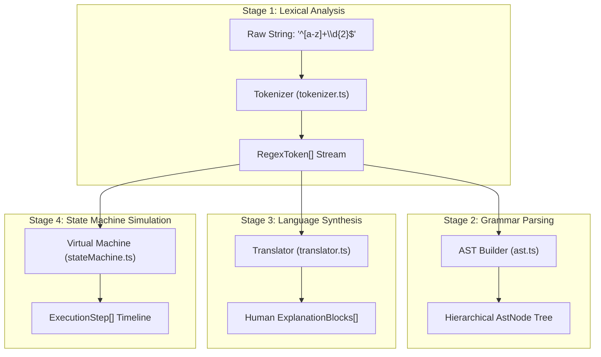

# RegexLab Parser Pipeline & Compiler Architecture

Welcome! This document provides a step-by-step walkthrough of how RegexLab transforms a raw regular expression string into tokens, an Abstract Syntax Tree (AST), a Finite Automaton state machine, and human-readable English explanations.

---

## 1. The 4-Stage Parsing Pipeline

Whenever you type or edit a regular expression in RegexLab, the data passes through a 4-stage compilation pipeline:

---

## 2. Stage 1: Lexical Analysis (`tokenizer.ts`)

The tokenizer scans through the pattern character-by-character and outputs a stream of typed `RegexToken` objects.

### Worked Example:
Input: `^cat+`

The lexer scans:
1. Index 0 (`^`): Identifies Anchor token `tok-0` (Start of String).
2. Index 1 (`c`): Identifies Literal token `tok-1` (Character 'c').
3. Index 2 (`a`): Identifies Literal token `tok-2` (Character 'a').
4. Index 3 (`t`): Identifies Literal token `tok-3` (Character 't').
5. Index 4 (`+`): Identifies Quantifier token `tok-4` (One or more repetitions, greedy).

Each token stores its byte offsets (`start`, `end`), allowing the UI to highlight corresponding characters bidirectionally when hovered.

---

## 3. Stage 2: AST Construction (`ast.ts`)

A flat list of tokens does not express parent-child relationships (such as tokens inside a group or tokens wrapped by a quantifier).

The AST parser uses a **Node Stack** algorithm to build a hierarchical tree:
1. Starts with an `Expression` root node on the stack.
2. When encountering a `group-open` token (e.g. `(` or `(?:`), it creates a `Group` node, adds it as a child of the current parent, and pushes it onto the stack.
3. Subsequent tokens become children of this nested group.
4. When encountering a `group-close` token `)`, it pops the group off the stack.
5. When encountering a `quantifier` token (e.g. `+`), it takes the preceding sibling node, wraps it inside a `Quantifier` node, and replaces it in the parent's children array.

---

## 4. Stage 3: Human Language Synthesis (`translator.ts`)

The translator converts cryptic syntax into natural human sentences:
1. **Consecutive Literal Aggregation**: When multiple literal characters appear in sequence without individual quantifiers (e.g. `'j'`, `'o'`, `'h'`, `'n'`), the translator combines them into a single phrase:
   - *"Match text 'john' (case sensitive)"*
2. **Quantifier Phrase Attachment**: Quantifiers are resolved into descriptive repetition bounds:
   - `{2,5}` $\to$ *"between 2 and 5 times"*
   - `+?` $\to$ *"1 or more times, lazy (shortest possible match)"*
   - `*` $\to$ *"0 or more times, greedy (as many as possible)"*
3. **Assertion Phrasing**:
   - `(?=...)` $\to$ *"Positive lookahead: asserts what follows matches..."*
   - `\b` $\to$ *"Word boundary: position between word character and non-word character"*

---

## 5. Stage 4: Virtual Machine Execution Simulator (`stateMachine.ts`)

To let users watch regular expressions execute in slow motion:
1. An outer loop advances the text search cursor `textPos = 0, 1, 2, ...`.
2. An inner loop steps through the pattern tokens.
3. Every test character, match confirmation, branch choice, and backtrack rewind is pushed to an `ExecutionStep[]` timeline array.
4. The timeline feeds the interactive D3 State Machine Graph and the playback ribbon.
